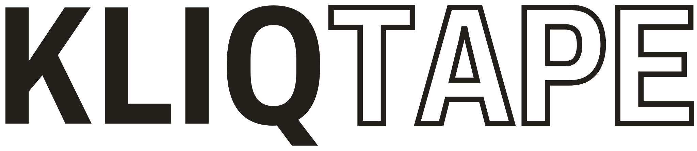
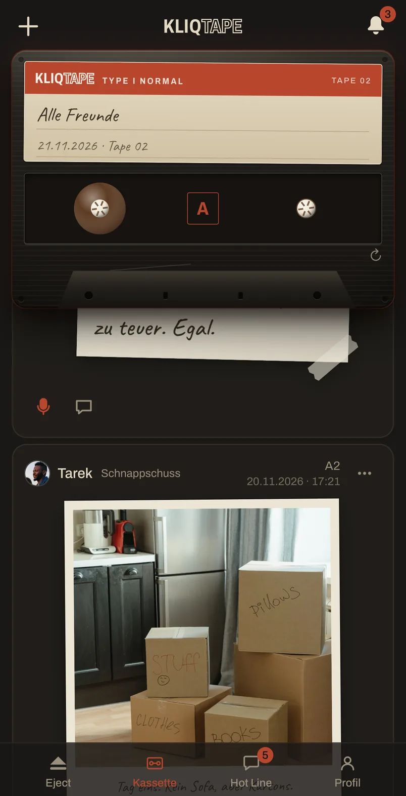
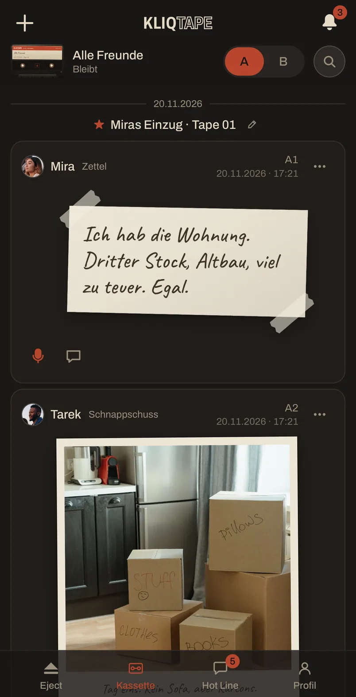
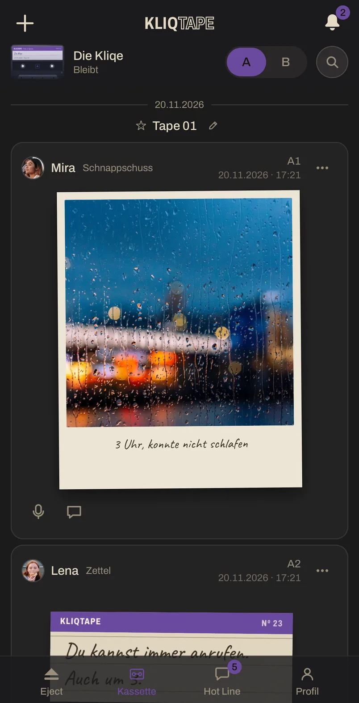
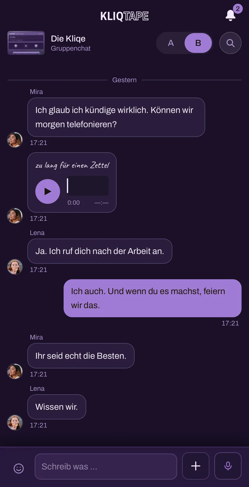
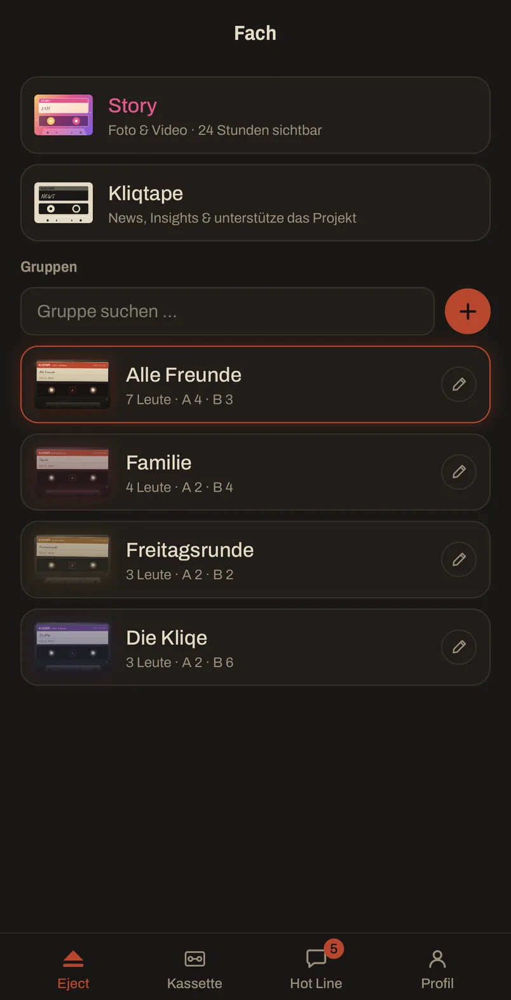
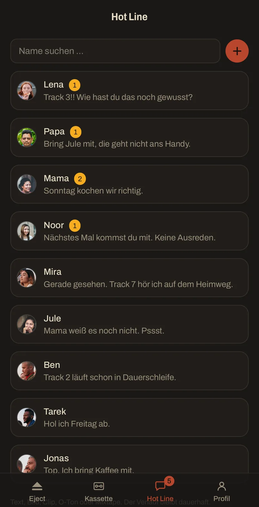
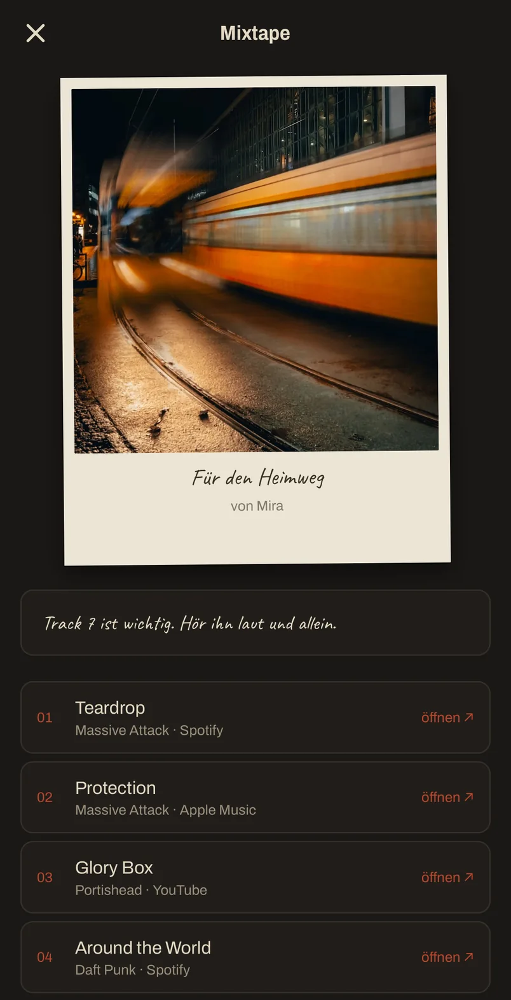
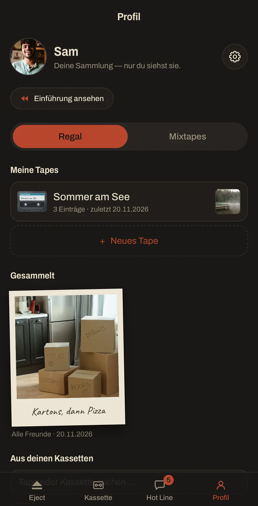
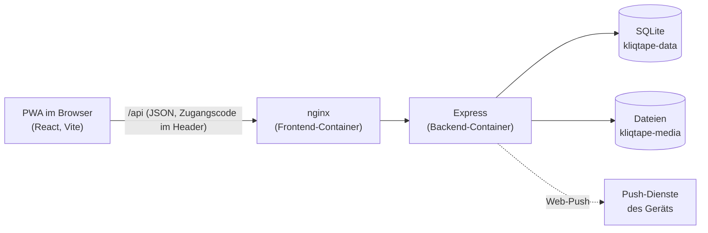

<h1 align="center">
  <a href="https://kliqtape.de"></a>
  &nbsp;
  <a href="https://kliqtape.de">
    <picture>
      <source media="(prefers-color-scheme: dark)" srcset="brand/logo/kliqtape-wortmarke-hell.svg">
      <source media="(prefers-color-scheme: light)" srcset="brand/logo/kliqtape-wortmarke-dunkel.svg">
      
    </picture>
  </a>
</h1>

<p align="center">
  <strong>Zwei Seiten. Eine Kassette.</strong><br>
  <a href="https://kliqtape.de">kliqtape.de</a>
</p>

<p align="center">
  <a href="https://github.com/Guppy997/kliqtape/actions/workflows/ci.yml"></a>
  
  
  
  
  
  
</p>

> **In short (English):** Kliqtape is an ad-free, algorithm-free social app for small, fixed
> groups of friends. Every group is a cassette: side A is the group's lasting archive, side B
> its ongoing group chat. No follower counts, no likes, no feed ranking. This repository is a
> working web prototype (PWA, React + Express + SQLite); the target platform is React Native.
> Documentation is in German.

Ein Regal voller Kassetten. **Jede Kassette ist eine Runde von Leuten** — du legst die
ein, mit der du gerade redest. Man hat nicht *einen* Freundeskreis, sondern mehrere,
und die zu vermischen funktioniert nicht.

Jede Kassette hat zwei Seiten:

- **Seite A — bleibt.** Das Archiv der Runde: Bilder, Absprachen, Infos. Filterbar nach Art.
- **Seite B — läuft weiter.** Der Gruppenchat der Runde, dauerhaft.

Ein Tipp auf den A|B-Schalter oben dreht die Kassette um. Chronologisch, ohne Algorithmus, ohne Werbung,
ohne Zahlen.

## Inhalt

- [So sieht es aus](#so-sieht-es-aus)
- [So funktioniert es](#so-funktioniert-es)
- [Funktionen](#funktionen)
- [Stand des Prototyps](#stand-des-prototyps)
- [Plattform und Betrieb](#plattform-und-betrieb)
- [Starten](#starten)
- [Testdaten](#testdaten)
- [Architektur](#architektur)
- [Sicherheit und Datenschutz](#sicherheit-und-datenschutz)
- [Entwicklung](#entwicklung)
- [Projektstruktur](#projektstruktur)
- [API](#api)
- [Datenmodell](#datenmodell)
- [Gestaltung](#gestaltung)
- [Grenzen und Ideen](#grenzen-und-ideen)
- [Mitmachen](#mitmachen)
- [Lizenz, Name und Logo](#lizenz-name-und-logo)

## So sieht es aus

Echte Screens aus dem Prototyp mit den Testdaten aus `scripts/seed.py`. Die Leute sind
erfunden, die Fotos stammen von [Pexels](https://www.pexels.com/license/).

<!-- Nach Kassetten geordnet: erst die rote „Alle Freunde“ (aufgeklappt und Seite A),
     dann die lila „Die Kliqe“ mit Seite A direkt neben Seite B. -->
<p align="center">
  
  
  
  
</p>

<p align="center"><sub>„Alle Freunde“: aufgeklappt · Seite A  ·  „Die Kliqe“: Seite A · Seite B</sub></p>

<p align="center">
  
  
  
  
</p>

<p align="center"><sub>Fach · Hot Line · Mixtape · Regal</sub></p>

## So funktioniert es

**Eine Kassette ist eine Runde.** Im **Fach** liegen deine Kassetten, jede in einer eigenen Bandsorte
(Amber, Ice, Atomic Purple, Tabak, Kiwi, Berry). Du legst die ein, mit der du gerade redest. Wer in
einer Runde ist, sieht nur diese Runde, die Kreise vermischen sich nie.

**Zwei Seiten.** Der Schalter oben dreht die Kassette um:

- **Seite A bleibt.** Das Archiv der Runde, nach Tagen in Tapes gegliedert: Schnappschüsse als
  Fotoabzug, Zettel, O-Töne, Clips und Mixtapes, mit Track-Nummern statt Zeitdruck. Unter einem
  Beitrag stehen die Antworten, ein Tipp öffnet sie alle.
- **Seite B läuft weiter.** Der Gruppenchat der Runde, dauerhaft. Antworten auf einen Beitrag von
  Seite A stehen hier mit Zitat und unter dem Beitrag selbst.

**Reagieren ohne Zahlen.** Statt eines Likes hält man das Mikrofon gedrückt und schickt einen
**Tonfetzen**, eine kurze Sprachreaktion. Nur die Person, die gepostet hat, sieht und hört sie.
Es gibt keine Follower, keine Zähler und keinen Algorithmus, alles läuft chronologisch.

**Die Hot Line** ist eine offene Leitung zwischen zwei Personen, unabhängig von jeder Kassette, mit
Text, Fotos, O-Tönen und Mixtapes. Neue Nachrichten stehen mit einem Zähler an der Leitung, das
Gespräch mit der neuesten Nachricht steht oben.

**Das Profil ist deine eigene Sammlung**, nur für dich sichtbar: eigene Tapes wie ein Tagebuch,
gesammelte Tapes aus deinen Kassetten, selbst beschriftet. Ein öffentliches Profil gibt es
bewusst nicht.

## Funktionen

| Bereich | Was es kann |
|---|---|
| **Beiträge** | Mixtape, O-Ton (bis 90 Sekunden), Schnappschuss (live oder aus der Galerie, sichtbar unterschieden), Clip (bis 10 Sekunden), Zettel |
| **Zettel** | Sechs Arten: Tesa, Pin (Klebezettel), Tacker (Notizbuchseite), Klammer, Eselsohr und Etikett mit dem Farbstreifen der Kassette. Jeder Zettel liegt anders, wie in die Runde geworfen |
| **Mixtape** | Ein Geschenk an genau eine Person: bis zu 12 Titel, Cover, handgeschriebene Widmung. Als Entwurf sieht die Empfängerin nichts, erst das Versiegeln überreicht es. Als Bild speicherbar |
| **Wochen-Challenge** | Eine pro Woche für alle Kassetten, einmal gemacht und in mehrere Kassetten gelegt, sichtbar erst Sonntag 19 Uhr |
| **Imposter-Woche** | Ein Typ der Wochen-Challenge: Jede Runde ab vier Leuten spielt für sich, mit Auflösung, ohne Punkte |
| **Storys** | Foto oder Video, 24 Stunden sichtbar, kassettenübergreifend |
| **Album als PDF** | Alle Beiträge eines Tapes als PDF-Album, wer nicht drin sein will, kann sich ausnehmen |
| **Einladung als Brief** | Mit QR-Code, der Token gilt einmal und 14 Tage |
| **Kassette altert** | Alle 10 Tage eine Stufe: vergilbtes Etikett, Eselsohr, Kratzer, Staub |
| **Kamera-Zwang** | Fotos und Videos sind live aufgenommen oder als Galerie-Bild erkennbar markiert, Fokus auf echt statt perfekt |
| **Push** | Eine Erinnerung pro Woche für die Challenge, per Web-Push |
| **Datenschutz** | Export aller eigenen Daten und vollständiges Löschen des Kontos direkt in der App |

Details zu jeder Funktion stehen in [docs/CONCEPT.md](docs/CONCEPT.md).

## Stand des Prototyps

> [!WARNING]
> Das hier ist ein **Gefühls-Prototyp**, kein Produkt für echte private Inhalte. **Nichts ist
> verschlüsselt**, auch Seite B nicht. Betreibe ihn nur im eigenen Netz (z. B. Tailscale) und
> stelle keine echten privaten Inhalte hinein.

Der Prototyp existiert, um die Idee anfassbar zu machen: Dreht sich die Kassette gut? Fühlt sich
das Zurückspulen echt an? Macht die Kamera-Beschränkung Spaß oder nervt sie?

**Absichtlich noch nicht drin:**

| Fehlt | Stand im Prototyp |
|---|---|
| Ende-zu-Ende-Verschlüsselung | **Nichts** ist verschlüsselt, auch Seite B nicht. Die App sagt das selbst (Profil → Zahnrad → „Was der Server sieht“). |
| Konten mit Passkey | Ein Name plus Zugangscode pro Gerät, kein Passwort, keine E-Mail |
| Moderationsoberfläche | Melden speichert die Meldung nur, niemand bearbeitet sie automatisch |
| Medien nur für Mitglieder | Bilder sind über ihre zufällige ID abrufbar, auch die aus eigenen, privaten Tapes, außer Challenge- und Imposter-Beiträgen vor der Freigabe |

## Plattform und Betrieb

**Plattform:** Dieser Prototyp ist eine **PWA** (React + Vite, im Browser und als installierte
Web-App). Die **Zielplattform ist React Native** — der Web-Client hier dient dazu, das Konzept
anfassbar zu machen und mit echten Freundeskreisen zu testen, er ist nicht die Endarchitektur.
Das Backend (Express + SQLite) bleibt davon unberührt.

**Hosting-Modell:** Kliqtape läuft als **zentral betriebener Dienst auf Hetzner** und wird von
dort aus skaliert — wie ein normaler Social-Media-Server. Das ist der Standard für alle:
Nutzer:innen legen keinen eigenen Server an, sie melden sich einfach an. Zielgruppe sind
alle, nicht nur Leute, die selbst hosten würden.

**Selbstbetrieb ist ausdrücklich erwünscht.** Der Code steht unter AGPL-3.0. Vereine,
Hochschulgruppen, Familien oder andere Communities können einen eigenen Kliqtape-Server
betreiben, auf einem gemieteten Server oder sogar auf einem Raspberry Pi. Die offizielle App
verbindet sich dann wahlweise mit dem zentralen oder mit dem eigenen Server. So behält eine
Community ihre Daten komplett selbst und muss trotzdem keine eigene App bauen. Ein
dokumentiertes Paket dafür und die Server-Auswahl in der App kommen mit der nativen App.

Jeder Server steht für sich: Eine Kassette liegt auf genau einem Server, Server tauschen keine
Daten untereinander aus. Für kleine, private Runden ist das einfacher und sicherer als eine
Föderation. Ausgeschlossen ist sie damit nicht, sie kann später dazukommen.

Geschützt ist nur die **Marke**: Ein eigener Server darf sich nicht als das offizielle Kliqtape
ausgeben, und wer den Code verändert und eine eigene App daraus macht, gibt ihr einen eigenen
Namen und ein eigenes Logo (siehe [TRADEMARKS.md](TRADEMARKS.md)).

Das `docker-compose.yml` in diesem Repo ist derzeit die **Entwicklungs- und Beta-Umgebung**
(inklusive optionalem Tailscale-Sidecar für den Zugriff im eigenen Tailnet), nicht das
Produktions-Setup.

## Starten

```bash
cp .env.example .env      # Werte anpassen (mindestens TS_AUTHKEY, falls Tailscale genutzt wird)
docker compose up --build
```

Danach: **http://localhost:8099**

### Kamera und Mikrofon brauchen HTTPS

Browser geben `getUserMedia` nur in einem *secure context* frei. Das heißt:

- **`http://localhost:8099`** funktioniert vollständig (localhost gilt als sicher).
- **`http://<lan-ip>:8099`**: Kamera und Mikrofon bleiben **blockiert**.
- **`https://kliqtape.<tailnet>.ts.net`** funktioniert, Tailscale Serve liefert ein gültiges
  Zertifikat. Genau dafür ist der Sidecar da.

Ohne Tailscale testest du am besten direkt auf dem Rechner, auf dem Docker läuft.

### Für Vorführungen

Damit man in einer Vorführung nicht bis Sonntag warten muss: `DEMO_TOOLS=1` in der `.env`. Dann
lässt sich jeder Challenge-Typ sofort starten und der Sonntagabend vorziehen, die Imposter-Woche
ebenso. Im Betrieb bleibt das leer.

## Testdaten

Damit sich jede Funktion ansehen lässt, ohne alles von Hand anzulegen:

```bash
python3 scripts/seed.py --reset          # anlegen (vorher aufräumen)
python3 scripts/seed.py --reset --me Max # anderer Hauptnutzer
```

Erzählt eine kleine, zusammenhängende Geschichte statt Zufallsinhalt: Mira zieht um. Zehn
Leute, **vier Kassetten mit unterschiedlichen Besetzungen** (Alle Freunde, Familie,
Freitagsrunde, Die Kliqe), damit sichtbar wird, dass sich die Kreise nicht vermischen. Dazu
Zettel in fünf Arten, Schnappschüsse, O-Töne, vier Mixtapes (geschenkt, geteilt, per Hot Line
geschickt, als Entwurf), Tonfetzen, neun Hot-Line-Verläufe mit Fotos, O-Tönen und einem
Mixtape, ein eigenes Tape und eine gesammelte Kassette im Regal. Jede Kassette hat eine feste
Bandsorte aus den Kernfarben. Genau diese Daten zeigen auch die Screens oben und auf der Website.

Danach in der App als **Aaron** anmelden — das Skript gibt am Ende den Zugangscode aus.
Die Codes aller Testpersonen merkt es sich in `scripts/.seed-tokens.json` (nicht im Repo),
damit `--reset` sie wieder löschen kann. Ist der Name auf dem Server schon vergeben:
`--me-token <Zugangscode>`.

**Fotos:** echte Stockfotos von Pexels ([Pexels-Lizenz](https://www.pexels.com/license/)),
nur als ID im Skript. Beim ersten Lauf lädt es sie herunter und legt sie in
`scripts/.cache/photos` ab (nicht im Repo), danach geht es offline. Die Profilbilder der
Freunde sind Ausschnitte aus derselben Fotoserie wie das Gruppenfoto, es sind also wirklich
dieselben Leute. Ton entsteht als echtes WAV, weil der O-Ton-Spieler das Audio tatsächlich
dekodiert. Voraussetzung: Pillow zum Zuschneiden, z. B. in einer venv:
`python3 -m venv .venv && .venv/bin/pip install Pillow`.

**Clips fehlen in den Testdaten** — dafür bräuchte es ffmpeg. Videos lassen sich
in der App direkt mit der Kamera aufnehmen.

## Architektur



- **Frontend:** React 19, TypeScript, Vite, Tailwind v4, Zustand für flüchtigen UI-Zustand,
  TanStack Query für Serverdaten, PWA über `vite-plugin-pwa`. Die Kassetten in der Kassetten-Ansicht
  sind echte 3D-Körper (three.js, erst nachgeladen).
- **Backend:** Node 22, Express, TypeScript, SQLite über `better-sqlite3`. PDF mit `pdfkit` und
  QR-Code mit `qrcode`, Push mit `web-push`. Das PDF-Modul hat keinen Datenbankzugang.
- **Medien** liegen als Dateien im Volume `kliqtape-media`, die Metadaten in SQLite unter
  `kliqtape-data`. Ein Medium wird erst herausgegeben, wenn der Beitrag freigegeben ist.
- **Zeit** wird immer in Europe/Berlin gerechnet (`backend/src/time.ts`, im Frontend gespiegelt),
  damit jedes Mitglied denselben Tageswechsel sieht.
- **Single-Tenant:** Eine SQLite-Datei und ein Admin-Name pro Instanz. Für viele unabhängige
  Freundeskreise auf einem Server braucht es später Mandantenfähigkeit.

## Sicherheit und Datenschutz

- **Zugangscode statt Passwort:** Wer sich einen Namen nimmt, bekommt einen zufälligen Code. Der
  Server speichert nur dessen SHA-256-Hash. Es gibt keine E-Mail, kein Passwort und keine
  Cookies.
- **Mitgliedschaft wird bei jeder Route geprüft** (`requireIdentity`, `requireMember`). Zu jeder
  verändernden Route gibt es einen automatischen Test „Fremder darf das nicht“ und eine
  Gegenprobe. Das gehört zu den Regeln in [CONTRIBUTING.md](CONTRIBUTING.md).
- **Eingaben:** SQL ausschließlich mit Platzhaltern, Größenlimits für JSON und Uploads, gepackte
  Request-Bodies werden abgelehnt, ein Rate-Limit pro IP schützt die API.
- **Kontrolle über die eigenen Daten:** Export aller Daten und vollständiges Löschen des Kontos
  in der App. Das Löschen räumt auch leere Kassetten und „eingeladen von“ bei anderen weg.
- **Offen gesagt:** Der Server kann alle Inhalte lesen, auch Seite B. Die App erklärt das unter
  „Was der Server sieht“. Geplant ist Ende-zu-Ende-Verschlüsselung für Seite B über das
  Signal-Protokoll ([docs/CONCEPT.md](docs/CONCEPT.md) §8).
- **Abhängigkeiten:** Renovate hält sie aktuell, Dependabot meldet Lücken, die CI testet jeden Push.

Sicherheitslücken bitte vertraulich melden, wie in [SECURITY.md](SECURITY.md) beschrieben.

## Entwicklung

Node 22, wie im Docker-Image. `better-sqlite3` 11 baut nicht unter Node 26; ohne Node 22 im Pfad
hilft `npx -p node@22 -- <befehl>`.

```bash
cd backend  && npm install && npm run dev     # :3000
cd frontend && npm install && npm run dev     # :5173, proxyt /api auf :3000
```

### Tests und CI

```bash
cd backend  && npm test            # API-Tests gegen eine Wegwerf-Datenbank
cd backend  && npm run lint && npm run typecheck
cd frontend && npm run lint && npm run typecheck && npm run build
```

Die Tests starten den echten Server als eigenen Prozess (146 Stück). GitHub Actions führt dasselbe
bei jedem Push aus (`.github/workflows/ci.yml`).

### Versionen

Die Version steht in beiden `package.json` und im Changelog der App (`frontend/src/changelog.ts`),
die Änderungen laufen über Pull Requests. Was wann neu ist, zeigt die App unter „Was ist neu“.

## Projektstruktur

```
kliqtape/
├─ backend/                 Node + Express + TypeScript, SQLite (better-sqlite3)
│  ├─ src/server.ts         Einstieg: Middleware, Routen einhängen, Fehlerbehandlung
│  ├─ src/routes/           ein Modul pro Bereich: account, cassettes, posts, tapes,
│  │                        challenge, imposter, album, letters, reports, stories, news,
│  │                        hotline, mixtapes, privateTapes, push
│  ├─ src/access.ts         Zugangscode und Mitgliedschaft (requireIdentity, requireMember)
│  ├─ src/media.ts          Upload/Abruf und wann ein Medium (noch) nicht herausgegeben wird
│  ├─ src/time.ts           Tage, Tapes und Sonntagabend in Europe/Berlin
│  ├─ src/db.ts             Schema und Migrationen
│  ├─ src/print/            PDF für Album und Brief, ohne Datenbankzugang
│  └─ tests/                API-Tests gegen einen echten Server, Unit-Tests für die Zeitlogik
├─ frontend/                React 19 + TypeScript + Vite, Tailwind v4, Zustand + TanStack Query, PWA
│  ├─ src/components/       Oberfläche, eine Datei pro Baustein
│  ├─ src/lib/              API-Client, Zeitlogik (Spiegel von backend/src/time.ts), Zeichnen
│  └─ src/store/            kleine Zustand-Stores für flüchtigen UI-Zustand
├─ brand/                   Logo und Farbvarianten (nicht unter der AGPL, siehe TRADEMARKS.md)
├─ docs/                    CONCEPT.md (Konzept, Sicherheitsmodell, offene Punkte), Screenshots
├─ scripts/seed.py          Testdaten mit echten Fotos und Tonaufnahmen
└─ docker-compose.yml       Entwicklungs- und Beta-Umgebung
```

## API

Alle Endpunkte liegen unter `/api` und sprechen JSON. Fehler kommen als `{ "error": "…" }` mit
passendem Statuscode zurück. Fast alle Routen verlangen den Zugangscode im Header
`X-Auth-Token`, der zur genannten Person passen muss (offen sind nur `health`, `auth/claim` und der
Abruf von Medien über ihre zufällige ID). Insgesamt
89 Routen, hier nach Bereich:

| Bereich | Pfade (Auswahl) | Zweck |
|---|---|---|
| Konto | `POST /auth/claim`, `GET /auth/whoami`, `POST /auth/rename`, `DELETE /me` | Namen nehmen, anmelden, umbenennen, alles löschen |
| Profil | `GET/PUT /profiles`, `GET/PUT /me/onboarding`, `GET/PUT /me/pronouns`, `GET /export` | Profilbild, Einführung, Pronomen, Datenexport |
| Kassetten | `GET/POST /cassettes`, `GET/PATCH/DELETE /cassettes/:id`, `/cassettes/:id/members`, `/cassettes/:id/tapes/:n` | Runden anlegen, umbenennen, verlassen, Tapes benennen und sammeln |
| Einladungen | `POST /cassettes/:id/invites`, `GET /invites`, `POST /invites/:id/accept`, `POST /letters/redeem` | Einladen per Name, Link oder Brief, zustimmen |
| Beiträge | `GET/POST /posts`, `DELETE /posts/:id`, `GET /posts/:id/replies`, `POST /posts/:id/react` | Seite A und B lesen, posten, antworten, Tonfetzen |
| Medien | `POST /media`, `GET /media/:id` | Blob hochladen und abrufen |
| Mixtapes | `/mixtapes`, `/mixtapes/:id/tracks`, `POST /mixtapes/:id/seal` | Bauen, Titel setzen, versiegeln, verschenken |
| Hot Line | `GET/POST /hotlines/threads`, `GET /hotlines/threads/:id/messages`, `POST …/heard` | Leitungen, Nachrichten, gelesen markieren |
| Challenge | `GET /challenge`, `POST /challenge/entry`, `GET/PUT /challenges` | Wochen-Challenge machen, Kanal plant |
| Storys und Kanal | `/stories`, `/news`, `PUT /news/funding` | 24-Stunden-Storys, Kliqtape-Kanal |
| Regal | `/me/tapes`, `/me/tapes/:id/items`, `GET /me/shelf`, `GET/PUT /me/album` | Eigene und gesammelte Tapes, Album |
| Push und Melden | `/push/key`, `/push/subscriptions`, `POST /reports` | Web-Push, Beiträge melden |

## Datenmodell

SQLite, Schema und Migrationen in `backend/src/db.ts`. Die wichtigsten Tabellen:

| Tabelle | Inhalt |
|---|---|
| `person_tokens`, `profiles` | Name, Hash des Zugangscodes, Profilbild, Einführung, Pronomen |
| `cassettes`, `cassette_members`, `cassette_invites`, `invite_letters` | Runden, Mitglieder (mit Verwaltungsrecht), Einladungen und Briefe |
| `posts` | Beiträge beider Seiten: `side`, `kind`, `body`, `media_id`, `note_style`, `quoted_post_id` für Antworten |
| `media`, `reactions` | Dateien (Typ, Größe, Dauer) und Tonfetzen |
| `cassette_tapes`, `cassette_tape_favorites` | Benannte Tapes pro Kassette und die Sammlung einer Person |
| `mixtapes`, `mixtape_tracks` | Mixtapes mit Titeln, Widmung, Siegel |
| `hotline_threads`, `hotline_messages` | Leitungen zwischen zwei Personen und ihre Nachrichten |
| `challenge_weeks`, `challenge_entries`, `challenge_shares` | Wochen-Challenge, Beiträge und ihre Verteilung auf Kassetten |
| `imposter_weeks`, `imposter_entries`, `imposter_votes` | Imposter-Woche |
| `private_tapes`, `private_items` | Eigene Tapes ohne Runde |
| `stories`, `news_posts`, `project_funding` | Storys, Kliqtape-Kanal, Förderstand |
| `reports`, `push_subscriptions` | Meldungen, Web-Push-Abos |

## Gestaltung

**Retro sind die Materialien, modern ist alles andere.** Bandkorn, Filzstift, Fotoabzug, aber
saubere Typografie, großzügige Abstände, flüssige Bewegung. Kein Sepia über allem, keine
Holzoptik, keine künstlichen Kratzer.

**Schriften** laut Markenskill, beide SIL OFL und selbst gehostet: Archivo für alles (Wortmarke
700 bei Breite 75, Überschriften 700 bei 87,5, Bedienung 400 bis 500, Zahlen mit `tabular-nums`)
und Caveat für Handschrift auf Material. Die App nutzt Variable Fonts (`frontend/public/fonts`),
die PDFs feste Schnitte (`backend/assets/fonts`). Beides erzeugt `scripts/fonts.sh` aus
`google/fonts`, Lizenzen liegen daneben.

**Kassetten zum Anschauen** (Kassetten-Ansicht, Farbauswahl) sind echte 3D-Körper in WebGL
(`frontend/src/components/tape3d/`): ein Renderer für alle Kassetten, three.js wird erst
nachgeladen, ohne WebGL gibt es die flache Kassette. Im Feed, im Fach und in den Leisten bleibt
bewusst die kleine, ruhige Zeichnung.

## Grenzen und Ideen

**Bekannte Grenzen**

- Keine Ende-zu-Ende-Verschlüsselung, Identität nur über Name und Zugangscode
- Medien sind über ihre zufällige ID ohne Mitgliedschaftsprüfung abrufbar
- Ein Server pro Instanz mit einer SQLite-Datei, kein Backup-Konzept
- Der Web-Client ist ein Prototyp und nicht die Endarchitektur
- Clips lassen sich nicht in den Testdaten erzeugen (dafür bräuchte es ffmpeg)

**Als Nächstes**

- Konto mit Passkey und Wiederherstellung
- Ende-zu-Ende-Verschlüsselung für Seite B über das Signal-Protokoll
- Native App mit React Native und Auswahl des Servers
- Dokumentiertes Paket für den Selbstbetrieb

**Bewusst nicht geplant:** Suche über fremde Inhalte, öffentliche Profile, Reichweiten-Funktionen
jeder Art. Föderation zwischen Servern ist später denkbar, aber nicht ausgeschlossen oder zugesagt.

Die vollständige Liste mit Begründungen steht in [docs/CONCEPT.md](docs/CONCEPT.md), Abschnitte 11
und 16.

## Mitmachen

Wie man das Projekt lokal startet, welche Prüfungen vor einem Commit laufen und welche Regeln im
Code gelten, steht in [CONTRIBUTING.md](CONTRIBUTING.md). Sicherheitslücken bitte nicht als
öffentliches Issue melden, sondern wie in [SECURITY.md](SECURITY.md) beschrieben.

## Lizenz, Name und Logo

Der Code steht unter der [AGPL-3.0](LICENSE). Du darfst ihn nutzen, verändern und selbst
betreiben. Wer veränderten Code als Dienst anbietet, muss seinen Quellcode ebenfalls offenlegen.

**Name und Logo sind davon ausgenommen.** Wer einen eigenen Server mit der offiziellen App
betreibt, braucht dafür nichts weiter. Nur Forks mit eigener App bekommen einen eigenen Namen
und ein eigenes Logo, und kein Angebot darf den Eindruck erwecken, das offizielle Kliqtape zu
sein. Details stehen in [`TRADEMARKS.md`](TRADEMARKS.md), die Brand-Dateien liegen in
[`brand/`](brand/) und stehen nicht unter der AGPL.
